# ERD — accounts, gangs, and meetups

Design only, updated for DECISIONS #29–#36; #37 controls frontend migration to these contracts. Later decisions override #26–#28 where they conflict. No migrations, database changes, or endpoint implementation in this round. Details explicitly marked proposed/question are not new approved decisions.

## Relationships

```mermaid
erDiagram
    USERS ||--o| AUTH_IDENTITIES : authenticates
    USERS ||--o{ AUTH_SESSIONS : uses
    USERS ||--o| USER_PREFERENCES : configures
    USERS ||--o{ FRIEND_LINK_TOKENS : regenerates
    USERS ||--o{ FRIENDSHIPS : requester
    USERS ||--o{ FRIENDSHIPS : recipient
    USERS ||--o{ USER_BLOCKS : blocks
    USERS ||--o{ USER_BLOCKS : blocked
    GANGS ||--|| GANG_SETTINGS : configures
    GANGS ||--o{ GANG_MEMBERS : contains
    USERS ||--o{ GANG_MEMBERS : joins
    GANGS ||--o{ GANG_SETTING_CHANGES : records
    USERS ||--o{ GANG_SETTING_CHANGES : proposes
    GANG_SETTING_CHANGES ||--o{ SETTING_OBJECTIONS : receives
    USERS ||--o{ SETTING_OBJECTIONS : objects
    GANGS ||--o{ GANG_EVENTS : displays
    GANG_EVENTS ||--o{ EVENT_RECIPIENTS : notifies
    USERS ||--o{ EVENT_RECIPIENTS : receives
    GANGS ||--o{ GANG_JOIN_LINKS : offers
    GANGS ||--o{ MEMBERSHIP_REQUESTS : reviews
    USERS ||--o{ MEMBERSHIP_REQUESTS : target
    GANG_JOIN_LINKS o|--o{ MEMBERSHIP_REQUESTS : source
    MEMBERSHIP_REQUESTS ||--|{ MEMBERSHIP_ELECTORS : snapshots
    USERS ||--o{ MEMBERSHIP_ELECTORS : eligible
    MEMBERSHIP_ELECTORS ||--o| MEMBERSHIP_BALLOTS : votes
    MEMBERSHIP_ELECTORS ||--o| MEMBERSHIP_OBJECTIONS : objects
    GANGS ||--o{ MEETUPS : contains
    USERS ||--o{ MEETUPS : creates
    MEETUPS ||--o{ MEETUP_GUEST_LINKS : invites
    MEETUPS ||--o{ MEETUP_PARTICIPANTS : includes
    USERS o|--o{ MEETUP_PARTICIPANTS : participates
    MEETUP_PARTICIPANTS ||--o| MEETUP_ATTENDANCE : records
    USERS ||--o{ USER_TITLES : earns

    USERS {
        uuid id PK
        text display_name
        text display_name_key UK
        date birth_date "nullable private"
        enum gender "male female other unspecified"
        text bio "short nullable"
        text main_title_key "nullable"
        timestamptz created_at
    }
    AUTH_IDENTITIES {
        uuid id PK
        uuid user_id FK,UK
        enum provider "line only in v1"
        text provider_subject UK
        text provider_name "nullable"
        text provider_avatar_url "nullable"
    }
    AUTH_SESSIONS {
        uuid id PK
        uuid user_id FK
        text token_hash UK
        enum source "line or local_dev"
        timestamptz expires_at
        timestamptz revoked_at "nullable"
    }
    USER_PREFERENCES {
        uuid user_id PK,FK
        enum theme "default cute"
        enum language "th en"
        jsonb home_cards "ordered key and visible pairs"
        jsonb notifications "schema pending"
        jsonb privacy "schema pending"
        timestamptz updated_at
    }
    FRIEND_LINK_TOKENS {
        uuid id PK
        uuid user_id FK
        text token_hash UK
        timestamptz created_at
        timestamptz revoked_at "nullable"
    }
    FRIENDSHIPS {
        uuid id PK
        uuid requester_id FK
        uuid recipient_id FK
        enum status "pending accepted declined ended"
        timestamptz created_at
        timestamptz responded_at "nullable"
    }
    USER_BLOCKS {
        uuid blocker_id PK,FK
        uuid blocked_id PK,FK
        timestamptz created_at
    }
    GANGS {
        uuid id PK
        uuid created_by FK "audit only no powers"
        timestamptz created_at
    }
    GANG_SETTINGS {
        uuid gang_id PK,FK
        text name
        text picture_url "nullable"
        boolean harsh_titles_enabled
        enum admission_rule "majority_48h or auto_unless_objection_24h"
        int version
        timestamptz updated_at
    }
    GANG_SETTING_CHANGES {
        uuid id PK
        uuid gang_id FK
        uuid proposed_by FK
        int base_version
        jsonb before_values
        jsonb after_values
        enum effect "easier stricter general"
        enum status "pending applied cancelled superseded"
        timestamptz created_at
        timestamptz apply_after
        timestamptz applied_at "nullable"
    }
    SETTING_OBJECTIONS {
        uuid change_id PK,FK
        uuid user_id PK,FK
        timestamptz created_at
    }
    GANG_EVENTS {
        uuid id PK
        uuid gang_id FK
        uuid actor_id FK "nullable system"
        uuid setting_change_id FK "nullable"
        text kind
        jsonb data "structured not UI sentences"
        timestamptz created_at
    }
    EVENT_RECIPIENTS {
        uuid event_id PK,FK
        uuid user_id PK,FK
        timestamptz notified_at "nullable"
        timestamptz banner_seen_at "nullable"
    }
    GANG_MEMBERS {
        uuid id PK
        uuid gang_id FK
        uuid user_id FK
        timestamptz joined_at
        timestamptz left_at "nullable"
    }
    GANG_JOIN_LINKS {
        uuid id PK
        uuid gang_id FK
        uuid created_by FK
        text token_hash UK
        text code_hash UK
        timestamptz expires_at
        timestamptz revoked_at "nullable"
    }
    MEMBERSHIP_REQUESTS {
        uuid id PK
        uuid gang_id FK
        uuid target_user_id FK
        uuid proposed_by FK "nullable self-request"
        uuid source_link_id FK "nullable"
        enum kind "admission removal"
        enum rule "majority_48h auto_unless_objection_24h"
        enum status "open approved accepted rejected expired executed"
        int electorate_count
        int required_yes_votes "nullable auto rule"
        timestamptz created_at
        timestamptz closes_at
        timestamptz consented_at "nullable admissions only"
        timestamptz resolved_at "nullable"
    }
    MEMBERSHIP_ELECTORS {
        uuid request_id PK,FK
        uuid user_id PK,FK
    }
    MEMBERSHIP_BALLOTS {
        uuid request_id PK,FK
        uuid user_id PK,FK
        boolean approve
        timestamptz cast_at
    }
    MEMBERSHIP_OBJECTIONS {
        uuid request_id PK,FK
        uuid user_id PK,FK
        timestamptz created_at
    }
    MEETUPS {
        uuid id PK
        uuid gang_id FK
        uuid created_by FK
        varchar title "1 to 100 characters"
        timestamptz starts_at
        text timezone "proposed Asia/Bangkok"
        int schedule_version
        int min_people "nullable"
        int max_people "nullable"
        timestamptz created_at
    }
    MEETUP_GUEST_LINKS {
        uuid id PK
        uuid meetup_id FK
        uuid created_by FK
        text token_hash UK
        timestamptz expires_at
        timestamptz revoked_at "nullable"
    }
    MEETUP_PARTICIPANTS {
        uuid id PK
        uuid meetup_id FK
        uuid user_id FK "nullable guest"
        text guest_nickname "guest only"
        text guest_token_hash "guest only nullable"
        enum response "going maybe not_going nullable"
        timestamptz hidden_at "private nullable"
        int confirmed_schedule_version "nullable"
        timestamptz queue_entered_at "nullable"
        boolean seat_allocated
        timestamptz answered_at "nullable"
    }
    MEETUP_ATTENDANCE {
        uuid participant_id PK,FK
        enum status "pending attended absent"
        enum source "creator automatic nullable"
        uuid confirmed_by FK "nullable"
        timestamptz eligible_at
        timestamptz due_at
        timestamptz finalized_at "nullable"
    }
    USER_TITLES {
        uuid user_id PK,FK
        text title_key PK
        timestamptz earned_at
    }
```

PK = primary key, FK = foreign key, UK = unique key. Additional FKs: `GANGS.created_by`, link issuers, request proposers, guest-link issuers, attendance confirmers, and settings/event users reference `USERS`; main title references an earned `USER_TITLES(user_id, title_key)`. Ballot/objection `(request_id, user_id)` references the corresponding electorate row. Relationship edges omit some audit FKs for readability.

## Accounts, profile, friends, and preferences (#29, #30, #34–#36)

- LINE Login only in v1. Remove Google, email credentials, passwords, verification/reset, and account-linking flows. Retain `AUTH_IDENTITIES` with provider fixed to `line`; future providers require a new decision/migration. Sessions are app sessions, not LINE access tokens. Dev fixture users may have no LINE identity.
- App name is unique. LINE name can prefill signup but conflicts require another name. Proposed normalization remains trim + Unicode NFC + case folding; exact character/length policy is open. `bio` is optional; proposed limit 160 characters requires approval.
- Birthday is optional calendar date; gender defaults to unspecified. Both are owner-only, including in friend/profile/stat endpoints. v1 avatar comes from LINE per #36; remove upload/media tables from active v1 scope. Upload support from #27 is deferred, not implemented by this ERD. Cover is a theme color, not an uploaded image.
- Main title must be earned. Friends and gangs stats count accepted friendships and active memberships; attended meetup stats use finalized attendance, excluding hidden users and guests. Titles/pet awards use attendance, never raw going answers. Proposed unique reward source `(user_id, meetup_id, reward_kind)` prevents duplicate awards; reward ledger/pet schema is deferred to its feature contract.
- One ordered preference entry per known home card key, with visibility; reject duplicates/unknown keys when the card registry is agreed. Theme/language match current frontend values. Notification/privacy JSON schemas and bio limit need contracts before endpoints. Cover/theme, settings, profile statistics remain data, not UI text.
- Friends: exact app-name search only; no browse-all API. Requests require acceptance and can include mutual-friend counts. Enforce one unordered friendship pair and no self-request. Unfriend changes status silently and never alters gang memberships.
- `USER_BLOCKS` is directional; a block in either direction prevents discovery and requests, including via old links or a gang roster action. Recheck after token lookup and before mutation. Proposed mutual-friend filtering excludes blocked/private users; detailed privacy rules need approval. Block behavior inside existing gangs is an open question, not automatic removal.
- Friend link/QR contains an opaque token, not credentials or arbitrary user IDs. Regeneration revokes the old token atomically; a partial unique index allows one active token per user. Links lead to a request requiring acceptance. Daily request limit must be checked atomically; proposed 20/day in Asia/Bangkok is pending approval, not a LINE API limit. Existing request timestamps support counting; retries must not bypass the limit.

## Gang governance and admission (#31 supersedes owner rules)

- No owner/leader role or owner-only permissions. `created_by` is audit data only. A new gang starts with its creator as a normal member. Member removal uses majority vote; no direct owner removal or owner transfer endpoint.
- Any active member can change settings. General settings (name, picture, harsh titles) and stricter admission changes apply immediately. Easier admission changes wait 24 hours; any member objection before activation cancels the whole pending change. Every proposal/application/cancellation writes a timeline event and notifies all current members; recipients track banner visibility independently.
- Proposed classification: `majority_48h -> auto_unless_objection_24h` is easier; reverse is stricter. Settings changes mixing general/easier fields should be split into separate requests. Compare `base_version` at application time; never silently overwrite later changes. Supersede stale proposals and notify members. Classification of future settings must be explicit.
- Any currently active member can object to a pending easier change (not only original recipients). Objection vs activation is serialized in one transaction using server time. Audit old/new values and actor; notifications are in-app records here, not promises of LINE Messaging API push.
- Snapshot the admission rule and electorate at creation. `majority_48h` requires `floor(N / 2) + 1` yes votes within 48 hours; the member proposer contributes one yes. `auto_unless_objection_24h` approves after 24 hours only if no eligible objection exists; a single objection rejects it. Candidate consent is always required before membership is created. Link/QR/code never grants membership directly.
- Removal always uses majority/48 hours even in an auto-admission gang. Target voting eligibility is still a question; proposed exclude target from electorate and deny removal if no voters remain. Removal does not require target consent, unlike admission. Lock denominator and electorate; departed-voter eligibility and ballot editing remain open.
- Use composite FKs for votes/objections to frozen electorate, one ballot/objection per voter, at most one unresolved request per gang/target/kind, and one active membership per gang/user. Changing settings does not retroactively change open membership requests.
- Membership history stores repeated join/leave periods. Leaving/removal revokes access but retains historical answers unless hidden under #32. Last-member departure, gang archival, link expiry, and candidate acceptance expiry require decisions before implementing those paths.

## Meetup privacy and participant state (#32)

- A participant is an app member (`user_id` present) OR guest (`user_id` absent, nickname/token present), never both. Partial unique `(meetup_id, user_id)` for account participants. Unanswered members can be projected from eligible membership plus participant overrides; persist overrides for hidden state. Guest IDs are stable participant IDs, not fake user IDs.
- Hidden is private state separate from response. Filter hidden participants BEFORE grouping, counting, pagination, avatar previews, attendance exports, reminders, nudges, stats, feed and reward eligibility. Never emit hidden counts, hidden IDs, or gang member totals in meetup payloads. Do not label a hidden person as unanswered. No hidden event is posted to the gang timeline.
- Detail may include the caller's own hidden row for recovery, with caller-only `myState.hidden`; it must never include another hidden participant. Default home/calendar excludes caller-hidden meetups. Hidden list is caller-scoped and cannot retrieve another user's hidden rows. Creator cannot hide own meetup. Unhide does not broadcast the previous private state.
- A separately accessible gang roster can still enable guessing (#32 acknowledged limitation); no meetup endpoint should make subtraction easier by returning total roster size. Guest projections have no access to a gang roster or private profile.

## Lock, reconfirm, capacity, attendance, and guests (#33)

- Server computes `responseLocksAt = starts_at + 10 minutes`. Reject answer/clear/hide mutations at or after that instant with `RESPONSE_LOCKED` (proposal: hide/unhide shares this lock; see HANDOFF question). A frontend timer never authorizes writes.
- A time move by more than 60 minutes OR to a different calendar day increments `schedule_version` and invalidates old confirmations. Proposed day timezone is Asia/Bangkok, pending approval. Keep prior intent privately for audit but expose effective response as null and status `needs_reconfirm`; hidden people stay hidden and receive no reconfirm reminder.
- All writes use current schedule version to prevent stale responses racing with a time change. Reconfirmation explicitly records the current version. Visible old answers no longer contribute to going/maybe/not-going counts; `needsReconfirmCount` counts only visible pending reconfirmations. Small changes, rescheduling after lock/finalized attendance, and capacity effects need the policies listed in HANDOFF.
- `min_people`/`max_people` are null or positive integers; when both exist, min <= max. Minimum is informational, not automatic cancellation. Seats are allocated transactionally. Waitlisted means going intent without a seat, not an extra `MeetupResponse` enum value. Count actual allocated going separately from visible waitlist. FIFO uses `queue_entered_at` then participant ID as a tie breaker. Proposed guests consume seats too.
- Leaving/clearing/hiding an allocated going response frees a seat and promotes the earliest eligible visible confirmed waiter before the answer lock. Never promote hidden, stale, removed, or blocked guest credentials. What happens on capacity reduction, unhide, or vacancies after lock is pending policy. Store no duplicate aggregate counts.
- Attendance candidates are visible, current-version, allocated going participants at lock; waitlisted/maybe/not-going/unanswered are not attendance candidates. Proposed immutable eligibility snapshot is created at lock. Proposed confirmation window opens then and ends at `starts_at + 24 hours`; #33 does not define an end time, so this interpretation must be approved. Creator can mark attended/absent; automatic finalization marks unresolved eligible going as attended at deadline. Guests may be displayed but never earn account stats, titles, or pet rewards. Automatic finalization/rewards must be idempotent and survive restart.
- Guest link access is limited to one meetup plus an opaque guest session, never gang membership. Proposed links issued by members and managed per meetup; link scopes, attendee detail visibility, nickname edits, spam/rate limits, and link expiry need approval. Guest declines are not hidden-member events. Do not let a client impersonate a guest using only `participantId`.
- `DELETE response` returns caller to unanswered and is idempotent; no artificial server-side 4-second window. Frontend offers undo for 4 seconds but backend still enforces lock/version. Previous non-null answers can be restored by PUT; earlier hidden state is not restored by response undo. Reverting a going answer may rejoin the waitlist rather than reclaim the previous seat.

## Constraints, indexes, and concurrency

- Unique normalized app names; unique LINE identity; hashed session/link tokens only. Tokens and LINE secrets never appear in logs or committed files. Database timestamps use timestamptz; birthday uses date.
- Partial active-membership index `(gang_id, user_id) WHERE left_at IS NULL`; membership period CHECK; FK every actor. No current-time CHECK for future meetups: validate at create/time edit, allowing valid meetups to become past records.
- Settings and membership deadline indexes; meetup `(gang_id, starts_at, id)` for calendar; participant `(meetup_id, hidden_at, queue_entered_at, id)` for filtered state and promotion. Exact SQL/query plans belong to implementation.
- Authorization, capacity allocation, queue promotion, request finalization, settings activation, and reward source claiming require transactions/locking and concurrency tests. Read-time effective deadlines must not rely exclusively on a background timer.
- Never cascade away historical membership, votes, hidden privacy state, or attendance without a separately approved deletion/retention policy. Stat queries must use the same hidden exclusion policy as meetup reads.

## Deterministic mock scenarios

Examples describe distributions, not executable seeds. UUID labels are illustrative. Expanded shared types and frontend request answers are in HANDOFF.

| Scenario | Input/state | Expected result |
|---|---|---|
| LINE name collision | Existing Earth; LINE prefills Earth | Choose a unique app name; no second login method or account merge |
| Private profile | Bio present, birthday/gender set | Others see bio/LINE avatar; birthday/gender omitted |
| Four-member admission | A proposes E under majority | A supplies 1 yes; 3 of 4 approves; E must consent |
| Auto admission | No objection for 24 hours | Approve then require E consent; any eligible objection prevents approval |
| Easier setting | majority -> auto | Pending 24 hours, any member objection cancels; every state change notifies/timelines |
| General/stricter setting | Rename or auto -> majority | Immediate, with actor/old/new audit and member notifications |
| Removal | Majority request against member | No creator privilege or direct removal; target eligibility pending policy |
| Silent decline | A going, B maybe, C hidden, D unanswered | Public counts 1/1/0; list A/B/D only; no total members or hidden counter |
| Hidden recovery | C reads own hidden list | Only C gets own hidden state; creator hiding gets CREATOR_CANNOT_HIDE |
| Undo | New going cleared within UI 4 seconds | Unanswered unless lock/version prevents it; repeated DELETE has no extra effect |
| Answer boundary | At startsAt + 10 minutes | RESPONSE_LOCKED; before boundary may answer |
| Reconfirm | Move 61 minutes or across local day | Current visible answers become needs_reconfirm; hidden users stay excluded |
| Waitlist | Max 2; A/B seated; C/D queue | Counts going 2, waitlist 2; A clears before lock, C promoted first |
| Attendance | Eligible A/B; creator marks A absent | Unconfirmed B defaults attended at deadline; A stays absent |
| Guest | Nickname G joins via scoped link | Stable participantId, userId null, no membership/title/reward/profile stats |
| Friend privacy | A blocks B then regenerates link | B cannot discover/request A; old token stops working; no gang removal |
| Preferences | Save reorder/hide then sign in elsewhere | Server returns same known card order/visibility |

## Scope and open details

This is design/types only. No ORM dependency, migrations, local database, auth routes, guest routes, upload support, or frontend changes are added. No new DECISIONS entry is recorded until user approval of the implementation proposals. See HANDOFF for the Windows PostgreSQL/ORM/LINE/dev-login implementation plan and outstanding product questions.
