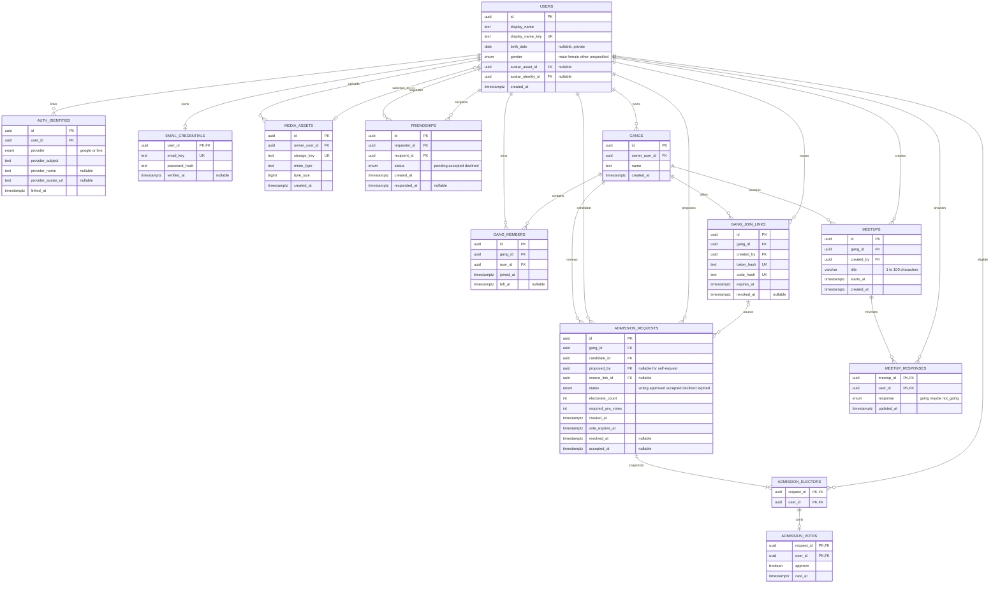

# ERD — accounts, gangs, and meetups

Design only. No tables, migrations, authentication, uploads, or endpoints have been created by this document. Approved product rules are recorded in DECISIONS #26–#28; implementation details below remain subject to schema review.

## Relationships

`USERS.avatar_identity_id` also references `AUTH_IDENTITIES.id`; this relationship is omitted from the diagram edges to keep it readable. PK = primary key, FK = foreign key, UK = unique key. All timestamps represent instants; API timestamps use ISO 8601 UTC. Birthday is a calendar date, not an instant.

## Accounts, profile, and privacy

- Google, LINE, and email/password can belong to one user. Enforce unique `(provider, provider_subject)` across external identities. Never merge accounts solely because provider emails match; linking requires an authenticated user and verification of the added method.
- Signup can prefill a provider name, but must obtain a unique app name before completion. `display_name` is the visible name; `display_name_key` is its normalized uniqueness key, not a second username. Proposed normalization: trim, Unicode NFC, and case folding. Exact length and allowed characters remain open.
- Birthday is optional. Gender defaults to `unspecified`; choices are `male`, `female`, `other`, `unspecified`, with localized UI labels. No free-text gender field is required. Birthday and gender are owner-only fields; public/member profile responses must omit them.
- Passwords are hashes only. Email verification and password recovery are required. Session storage, verification/reset token tables, hashing algorithm, and email delivery are a follow-up authentication design, not covered by this ERD.
- Avatar selection is either a linked provider identity or an owned uploaded asset, not both. No selection means a placeholder avatar. At signup a provider photo may be selected; uploading a photo selects that asset instead. Enforce that the selected identity/asset belongs to the same user. Do not return credential data or storage keys in public profiles.
- Upload storage backend, MIME allowlist, file size limits, and processing/cleanup policy must be specified before implementing uploads. A media row is metadata, not the image bytes.

## Friends and membership

- A friendship request needs acceptance. Reject self-requests. Enforce one row per unordered user pair, preventing opposite-direction duplicate requests; retry/unfriend/block rules are still open.
- One gang has one owner. Membership history uses separate rows for each membership period; a partial unique index on `(gang_id, user_id)` where `left_at IS NULL` prevents duplicate active memberships. Validate `left_at >= joined_at` when present.
- The gang creator becomes its initial owner/member atomically; admission voting applies to subsequent members. This is a proposed bootstrap detail. Owner transfer, owner departure, and removal procedures still need decisions; owner-only removal is not assumed approved.
- Leaving a gang removes read/respond permissions, but preserves prior meetup answers and their contribution to counts. Rejoining does not delete historical answers.
- Every active member may create, read, or respond to a meetup. Signed-in outsiders receive 404 for inaccessible meetups. This rule does not define the unauthenticated error contract.

## Admission voting and invitation channels

- Friend nomination, link, QR, and code all enter the same admission workflow. QR encodes a join link; it needs no separate table. A link/code is permission to request admission, not direct membership. Friend nomination requires an accepted friendship at proposal time.
- At request creation, snapshot all active members into `ADMISSION_ELECTORS`, freeze `electorate_count = N`, and set `required_yes_votes = floor(N / 2) + 1`. This includes the owner. Validate `N >= 1`.
- `ADMISSION_VOTES` has a composite foreign key `(request_id, user_id)` to `ADMISSION_ELECTORS`, so only snapshot members can vote and each has at most one ballot. A member proposer gets one automatic yes vote. Self-requesting candidates do not vote.
- `vote_expires_at = created_at + 48 hours`. Only votes received before the deadline count. Majority means more than half of all snapshot members, not half of votes cast. Non-voters do not reduce the denominator.
- Proposed transitions: `voting -> approved` once the threshold is met; otherwise `voting -> expired` at the deadline. Approved candidates must accept before `accepted` creates membership. Candidate refusal becomes `declined`. No direct-add path bypasses approval or candidate consent.
- Creating an electorate, recording proposer consent, and calculating the threshold must be atomic. Acceptance must atomically verify approval, insert at most one active membership, and mark the request accepted. Use a partial unique index to allow at most one `voting` or `approved` request per `(gang_id, candidate_id)`.
- Link token/code values are returned only when issued; persist hashes. Link expiry/revocation prevents new requests. Link lifetime, code strength, acceptance expiry, ballot editing/visibility, and the right of departed snapshot voters to cast a later vote remain open. Membership changes never alter the frozen denominator.
- Existing meetup/restaurant vote policy is separate from membership admission; do not assume all vote-engine rules apply to admission ballots.

## Meetup constraints and indexes

- Preserve the shared `MeetupSummary`/`MeetupDetail` shape: `gangName` is joined from gangs; `counts` is aggregated from answers; `myResponse` is selected for the authenticated caller. Do not store these derived fields in `MEETUPS`.
- Trim titles; enforce 1–100 characters. Validate future `starts_at` on creation or when changing the time. Do not add a database CHECK against the current time; valid records naturally become past meetups.
- `MEETUP_RESPONSES` has primary key `(meetup_id, user_id)`. Upsert updates a member's existing answer. Repeating an answer does not increment counts. No row means unanswered, including for the meetup creator.
- Membership checks and writes must be consistent under concurrent leave/respond or leave/create requests; a user FK alone does not prove current gang membership.
- Proposed indexes: `AUTH_IDENTITIES(user_id)`, `FRIENDSHIPS(recipient_id, status)`, `GANG_MEMBERS(user_id, gang_id)` for active rows, `ADMISSION_REQUESTS(status, vote_expires_at)`, and `MEETUPS(gang_id, starts_at, id)`. Composite primary keys already support count queries by meetup and ballots by request. Exact SQL and query plans are a migration-stage task.
- Deletion/cascade policies remain open; do not cascade away historical memberships, ballots, or responses without an approved policy.

## Deterministic mock scenarios

Illustrative IDs below are labels, not production UUID fixtures. These are documentation examples, not executable seeds or frontend screens.

| Scenario | Input/state | Expected result |
|---|---|---|
| Unique app name | Existing `Earth`; attempt ` earth ` | Conflict under proposed normalized-name key; ask for another name |
| Optional private profile | Birthday absent, gender unspecified | Signup allowed; another member sees neither field |
| Provider and upload avatar | Provider image selected, then upload owned image | Uploaded image becomes selected; provider identity remains linked |
| First member | Gang created by user A | A becomes owner and first active member atomically |
| Four-member admission | A/B/C/D snapshot; A proposes E | Threshold 3; A supplies first yes; a second yes is insufficient; third approves |
| Candidate consent | E is approved but has not accepted | E is not a member; acceptance adds one active membership |
| Deadline | Four voters, two yes votes at 48 hours | Expired; E remains outside the gang |
| Frozen denominator | Four-voter snapshot; membership later changes | Threshold stays 3; departed-voter eligibility is pending decision |
| No bypass | Outsider F opens join QR | Creates/request admission flow; no direct membership grant |
| Unanswered meetup | Creator A and other members have not answered | `myResponse: null`, all three counts 0 |
| All response states | A=going, B=maybe, C=not_going, D unanswered | Counts 1/1/1; D sees `myResponse: null` |
| Change answer | A changes going to maybe | Counts 0/2/1; repeating the same request leaves them unchanged |
| Former member | C leaves after answering not_going | Count retains C's answer; C cannot read or respond and receives 404 |

## Scope

This ERD covers the approved account/profile, friends, gang admission, and meetup design. Database runtime, migrations, auth provider setup, upload implementation, API implementation, frontend mockups, pets, bills, and restaurant/time voting are outside this documentation change. Docker is not needed to view or validate these documents.
